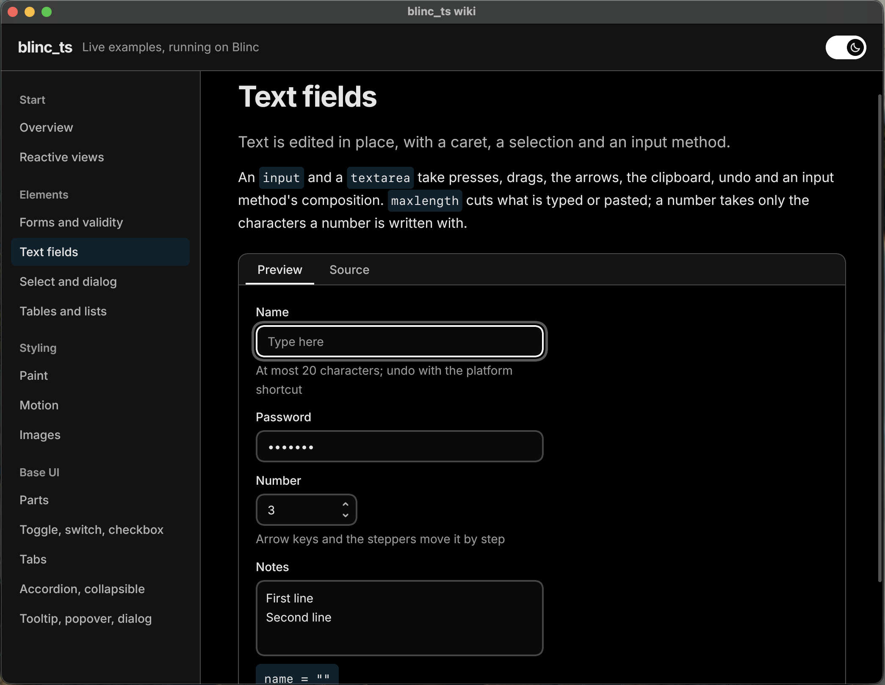

# blinc_ts

Framework agnostic TypeScript SDK for native UI rendering, layout and reactivity.
Use it directly from TypeScript or JavaScript, or connect a framework to its
primitives. Components and styling belong to the TypeScript layer.



## Get started

The wiki is the guide. It is a Blinc app: a native window of pages, each with live examples
beside the source that makes them, so you use a part before you read how it is made. It covers
writing an adapter for any framework, the elements and behaviours the host provides, styling
and motion, and the Base UI parts.

```sh
npm ci
npm run build:native   # once, and after native changes; needs a Rust toolchain
npm run wiki
```

Before `build:native`, place `blinc_abi`, `x-idl`, `xgpu` and `xwindow` beside this repository, as
[the contributor setup](docs/native.md#contributor-setup) describes. `npm run wiki` builds the
SDK and the adapters, then opens the window.

- Pick a page in the navigation. Each example has a **Preview**, which is live (press it, type in
  it), and a **Source** tab with the code behind it.
- The switch at the top right changes the colour scheme, and the header stays where it is as a
  page scrolls.
- The pages and their examples are `adapters/wiki/pages.tsx` and `adapters/wiki/examples/`. Add
  an example there and run `npm run wiki` again to see it.
- No display? `npm run test:adapters` draws every page offscreen to `.blinc/wiki/`.

## Development

Requires Node.js 22.13+.

```sh
npm ci
npm run check
npm run dev
```

The headless Vite example demonstrates HMR. Edit `examples/hmr/app.ts` to replace
the UI scope while keeping its host alive. The [native example](docs/native.md)
opens a real window and preserves its window and GPU device through accepted
updates.

## Current status

**Rendering and layout.** [Owned layout trees](docs/native.md#owned-layout-trees),
[native reactivity](docs/native.md#reactive-contexts),
[scene encoding, text and images](docs/native.md#owned-scenes-and-images), and
[a native scene renderer](docs/native.md#drawing-a-scene) with gradients, clipping, shadows,
filters, masks, blur and liquid glass, [custom GPU canvases](docs/native.md#gpu-canvases),
[native scene windows](docs/native.md#native-scene-windows) and
[TypeScript shaders](docs/shaders.md). Native rendering is tested on macOS with Metal and in CI
on Linux with software Vulkan, under X11 and Wayland.

**A host for any framework.** The [host interface](docs/native.md#host-interface-for-frameworks) is
a document-like tree an adapter creates, edits and listens to. CSS is parsed and applied in Rust
(the cascade, colours, gradients, glass, transforms, filters, masks, clip paths, backgrounds from
images, transitions, keyframes and layout animation), with [themes](docs/native.md#themes) and a
user-agent stylesheet. The host gives elements their behaviour, so an adapter gets it too: lists,
links and labels, forms with validity, inputs, selects, dialogs, tables, text fields with
selection, undo and an input method, an inline text flow, scrolling, a top layer for popovers and
tooltips, and images decoded off the main thread.

**Adapters and components.** Two reference adapters are in `adapters/`, outside the SDK: a
[JSX runtime](docs/native.md#host-interface-for-frameworks) with signals, control flow and owners,
and a Vue renderer. [Base UI parts](docs/base-ui.md) (toggles, tabs, accordions, tooltips,
popovers, dialogs) are built on the first, and the wiki above is built from them.

**Tooling.** Vite HMR that keeps the native window and GPU device through accepted updates,
compile-time CSS, and [offscreen visual and motion inspection](docs/snapshots.md): filmstrips,
trails, pixel and geometry diffs, and per-element curve sheets.

**Not yet.** A published package (the commands here are for contributors), an accessibility tree,
a 2D canvas context, `calc()` in lengths, `rowspan`, and a select with `multiple`. The package is
private, and comparative framework measurements remain in progress;
[full-scene benchmarks](docs/performance.md#full-scene-renderer-benchmark) cover text lists,
image cards and layered glass.

## Architecture

| Layer                                                   | Responsibility                                             |
| ------------------------------------------------------- | ---------------------------------------------------------- |
| [blinc_abi](https://github.com/project-blinc/blinc_abi) | Native graph, layout, text, display lists and hit testing  |
| [x-idl](https://github.com/rayzor-blade/x-idl)          | Shared API model and generated runtime bindings            |
| [xgpu](https://github.com/rayzor-blade/xgpu)            | GPU resources and execution                                |
| [xwindow](https://github.com/rayzor-blade/xwindow)      | Windows, input and platform events                         |
| TypeScript                                              | Renderer orchestration, CSS, themes, motion and components |
| [TypeGPU](https://github.com/software-mansion/TypeGPU)  | Typed shaders compiled to WGSL                             |

See [architecture](docs/architecture.md), [Vite and HMR](docs/tooling.md),
[code conventions](docs/contributing.md), and [performance](docs/performance.md).

Apache-2.0.
